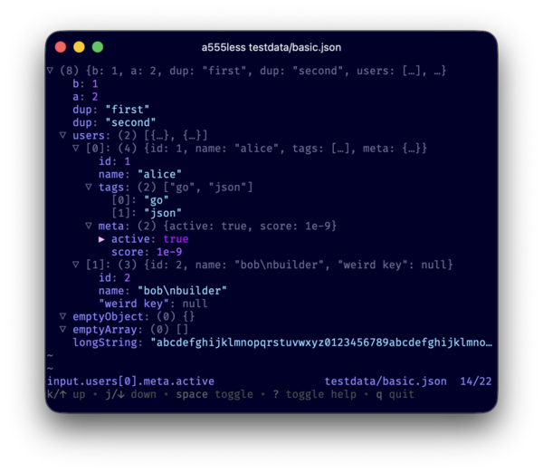

<p align="center"></p>

# a555less

[](https://github.com/acidghost/a555less/actions/workflows/ci.yaml)
[](https://github.com/acidghost/a555less/actions/workflows/release.yaml)

A small Go terminal JSON viewer inspired by the data-mode subset of [`jless`](https://github.com/PaulJuliusMartinez/jless).

## Install

Versioned binaries are published to [GitHub Releases](https://github.com/acidghost/a555less/releases)
for macOS (`arm64`) and Linux (`arm64`, `amd64`). With Go and the GitHub CLI installed:

```sh
os=$(go env GOOS); arch=$(go env GOARCH)
tag=$(gh release view --repo acidghost/a555less --json tagName --jq .tagName)
archive="a555less_${tag#v}_${os}-${arch}.tar.gz"
gh release download "$tag" --repo acidghost/a555less --pattern "$archive"
gh attestation verify "$archive" --repo acidghost/a555less
tar -xzf "$archive" a555less
mkdir -p ~/.local/bin
install a555less ~/.local/bin/a555less
```

Or build from source:

```sh
git clone https://github.com/acidghost/a555less.git
cd a555less
just install
```

## Usage

```sh
a555less file.json
a555less < file.json
a555less --version
```

## Keys

```
q, ctrl+c                 quit
j, down                   down
k, up                     up
space, enter              toggle
h, left                   collapse/parent
l, right                  expand/child
g, home                   top
G, shift+g, end           bottom
pgdown, pagedown, ctrl+f  page down
pgup, pageup, ctrl+b      page up
ctrl+d                    half down
ctrl+u                    half up
H                         parent
J                         next sibling
K                         prev sibling
c                         collapse siblings
C, shift+c                deep collapse siblings
e                         expand siblings
E, shift+e                deep expand siblings
/                         search
n                         next match
N                         previous match
pp                        print focused value, pretty-printed
ps                        print focused string contents
pq                        print jq query for focused value
?                         toggle help
```

Searches are case-insensitive by default. Append `/s` to the search text to make a search case-sensitive.

## Contributing

Use `mise install` to get the pinned tools, or install Go, `just`, `golangci-lint`, `shfmt`, and `shellcheck` yourself.

```sh
just fmt
just lint
just lint-sh
just test
just build
just e2e/run   # requires tmux; run after just build
```

Keep changes small and include tests when changing parser, rendering, or navigation behavior.
